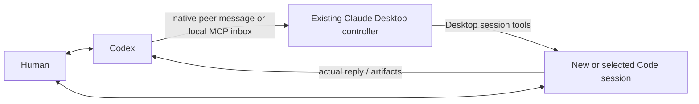

# Codex–Claude Desktop Session Controller

[详细中文说明](README.zh-CN.md) · [Usage](docs/USAGE.md) · [Comparisons](docs/COMPARISON.md) · [Privacy](SECURITY.md) · [Validation](docs/VALIDATION.md)

A Windows-first Codex skill for working with **visible Claude Desktop Code sessions**. Codex can ask an existing Claude controller to create a fresh work session, continue an explicitly selected session in another project, read its history/results, and stop an authorized current turn. The person keeps the original Desktop conversation and can interrupt or take over there.



This is a task-oriented controller workflow, not an independent inference service. Creation is performed by Claude Desktop's in-session tools, not by running a hidden `claude -p` first turn and importing it. The bridge does not decrypt account OAuth caches, install debugger hooks, patch apps, or select a model/permission mode for the user. Native sends still use the local peer credential. All receiving-session rules continue to apply.

## Requirements

- Native Windows; original live checks used Claude Desktop Code. Hosted Chat, Cowork, WSL and macOS are not validated.
- Working Codex and Claude Desktop Code installations. Claude's existing sign-in/inference route must already work. No additional model API key is requested by this bridge; **this does not establish account-free or login-free operation**.
- Node.js 22+ and Python 3.11+. The controller's Python needs `mcp==1.26.0`, the SDK version used in protocol validation.
- A user-enabled, reachable Claude Desktop controller session. Automatic app startup and controller recovery are not implemented.

## Install

Clone into a permanent source directory, then choose a **separate empty workspace** for the controller. Example paths below are fictitious; use your own:

```powershell
git clone https://github.com/Drew593990/codex-claude-desktop-session-controller.git
Set-Location codex-claude-desktop-session-controller
python -m pip install -r requirements.txt
python scripts/install.py --workspace 'D:\Projects\claude-desktop-native-bridge' --register
```

If Python or Node are not on PATH, invoke your Python executable and pass `--node '<node executable>'`. `--python` can select the controller interpreter, which must have the MCP SDK. Codex home defaults to `CODEX_HOME` or `~/.codex`; `--codex-home` overrides it.

The installer does **not** install dependencies, start models, run a task, modify Claude account settings, or change tool permissions. It:

1. Copies `bridge.py`, `client.py`, `native-controller.cjs` and controller instructions into the chosen workspace.
2. Merges the project `codex_bridge` server into `.mcp.json`, preserving other servers and refusing an unrelated conflicting server.
3. Renders the Codex skill with your local paths under your Codex home.
4. With `--register`, backs up and adds the skill's enabled path and a marked rule block in Codex `config.toml` / `AGENTS.md`. Without it, those two global files are untouched.

Existing changed managed files are not silently overwritten. A second identical install is safe; runtime files and configuration backups stay local.

## Enable the controller once

Open the chosen workspace as a **local Code project in Claude Desktop**. Enable its project MCP server through Claude's normal authorization. In that Desktop chat, send:

> Enable Codex receiving in this project. Follow CLAUDE.md, report bridge_status, then call wait_for_task. Display received tasks and results in this chat. Stop receiving when I take over or ask you to stop.

In Codex, refresh skill discovery or start a new chat if needed. Then request, for example:

> Use `$codex-claude-desktop-session-controller`: ask Claude to review this file read-only and report specific findings.

The skill finds the existing controller and creates a **new work session** by default. The controller is a management session, not the worker. For a known old session, say:

> Continue the existing Claude Desktop Code session “My research session”. Read its recent history, then ask it to verify the attached derivation. Do not create a replacement or modify files.

Existing sessions can belong to another project directory. The bridge workspace is the default new-session location, **not** a restriction on which old sessions are addressable. The same work session is used for follow-ups.

## What is and is not confirmed

The prototype was live-tested for native wakeup, new-session creation, actual message/reply reading, stopping a test turn, and cross-project continuation of an existing research session. Those are historical checks on one Windows setup, not an automated compatibility matrix. The portable installer is validated with temporary fixtures; it has not replaced or reconfigured that original live installation. See [validation boundaries](docs/VALIDATION.md).

- A successful pipe write is not a read receipt or finished task.
- The MCP queue is in-memory; audit logs do not automatically restore it.
- Human takeover is provided by the original Desktop chat. No unified conversation panel or full-duplex unsolicited Claude-to-Codex notification system is included.
- No automatic split screen, login, permission approvals or app cold-start automation.
- Local application protocols and Desktop tool schemas may change.

## Related projects

[Triangle Bridge](https://github.com/heelee912/triangle-bridge) overlaps substantially and has broader multi-app operations and stronger transport reconciliation. [KeeVeeG's Desktop Bridge](https://github.com/KeeVeeG/codex-claude-desktop-bridge) offers bidirectional messaging and a manual conversation panel. [AgentBridge](https://github.com/raysonmeng/agent-bridge) and [CCB](https://github.com/SeemSeam/claude_codex_bridge) provide other visible multi-agent workflows. This project claims neither novelty nor overall superiority. Its narrow choice is a Claude in-session controller with explicit new/existing-session policy and user-preserving defaults. Read the [code-based comparison](docs/COMPARISON.md).

## Development

```powershell
python -m pip install -r requirements.txt
python -B -m unittest -v test_bridge
python -B tests/test_install.py -v
python -B tests/test_public_scan.py -v
node --test native-controller.test.cjs
python scripts/check_public.py
```

Tests use synthetic fixtures and local protocol processes, not live research sessions. They do not start a Claude model. See [contribution guidance](CONTRIBUTING.md). MIT licensed; independent of OpenAI and Anthropic, without their endorsement.
